# Using the Provided Quality Control Functions

This document presents several examples of using the provided QC functions. These examples
should provide you with a good overview of the offered functionality and potential limitations.

## Suggested Workflow

This library is not suited for running the provided QC methods on complete WSIs.
Instead, the functions are expected to be run on smaller WSI regions and regular PNG/JPG images.
This should provide reasonable options for debugging potential problems, while avoiding
the technical overhead needed for processing the complete WSIs.

For processing complete WSIs, we suggest considering the [RationAI QC Service](https://gitlab.ics.muni.cz/rationai/digital-pathology/quality-control/service),
which uses the provided QC functions and is optimized for processing complete WSIs.
Be sure to check the service's [documentation](https://quality-control-rationai-digital-pathology-quali-82f7255ed88b44.gitlab-pages.ics.muni.cz/feature-qol-improvements/)
for more information on how to use it.
(*Please note that the link to the documentation may change in the future. Please let us know if you encounter any issues with accessing the documentation.*)

## Examples

The following examples should provide you with the necessary information for running the provided QC functions.

### Detecting Residual Artifacts

In this example, we will work with the following image:

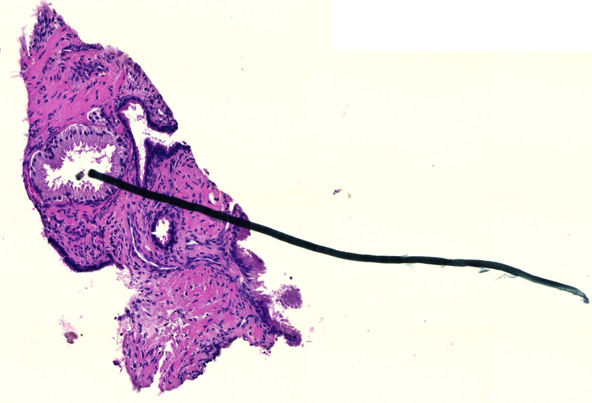

#### Sample Code

First, we need to import the necessary functionality and load the image into numpy array:

```python linenums="1"
import numpy as np
from PIL import Image
from rationai.staining import StandardConversions

from rationai.qc import (
    NegativeChannel,
    StandardResidualThresholds,
    residual_artifacts_and_coverage,
)
from rationai.qc.residual_artifacts import visualize_thresholds


img = np.asarray(Image.open("input.png").convert("RGB"))
```

Next, we will need to prepare the arguments for the [residual_artifacts_and_coverage](../api/residual_artifacts/residual-artifacts-and-coverage.md)
function and call it on the input image:

```python linenums="15"
conversion = StandardConversions.RGB2HER
nucleus_area = 30
thresholds = StandardResidualThresholds.HER
suppression_channel = NegativeChannel.C2
erosion_radius = 5

artifacts = residual_artifacts_and_coverage(
    img,
    conversion=conversion,
    nucleus_area=nucleus_area,
    thresholds=thresholds,
    suppression_channel=suppression_channel,
    erosion_radius=erosion_radius,
)
```

Since the tissue is stained with the **H&E protocol**, we used the `RGB2HER` color conversion, which separates
the image into the hematoxylin, eosin, and residual channels. Artifacts are detected by thresholding
the negative parts of all three channels and the positive part of the third (residual) channel.
The used thresholds are the suggested values for the `RGB2HER` conversion provided by the `StandardResidualThresholds` class.

The nucleus area is manually approximated from the input image (nuclei are roughly 6 pixels wide),
and all detections smaller than a single nucleus are removed.

Finally, in H&E stained tissue, clusters of tightly packed nuclei can produce negative values in the eosin channel
and be incorrectly marked as artifacts. To prevent this, we set the `suppression_channel` parameter to the negative part
of the eosin channel (`NegativeChannel.C2`). In this channel, only the detections that survive erosion with a disk
of radius `erosion_radius` are kept. Therefore, small clusters of nuclei are removed, while larger artifacts are preserved.

After obtaining the results, we can save the binary artifact mask and print the number of examined and flagged pixels:

```python linenums="30"
mask = Image.fromarray(255 * artifacts["artifacts_per_pixel"].astype(np.uint8))
mask.save("residual_mask.png")

print(f"Number of flagged pixels: {artifacts['number_of_flagged_pixels']}")
print(f"Number of examined pixels: {artifacts['number_of_examined_pixels']}")
```

The computed mask is returned as a binary image. Therefore, the computed values need to be scaled into the `[0, 255]` range before visualization.

If the suggested thresholds do not fit your data, the `visualize_thresholds` function can help with tuning them.
It returns four images (one for each thresholded channel), in which only the pixels exceeding the corresponding threshold
keep their original color:

```python linenums="36"
c1_neg, c2_neg, c3_neg, c3_pos = visualize_thresholds(img, conversion, thresholds)

c1_neg.save("c1_negative.png")
c2_neg.save("c2_negative.png")
c3_neg.save("c3_negative.png")
c3_pos.save("c3_positive.png")
```

#### Results

In our example, 18327 out of the 233744 examined pixels were labeled as artifacts,
meaning that **almost 8% of the image's foreground area** is covered by artifacts.
Finally, the computed artifact mask looks like this:

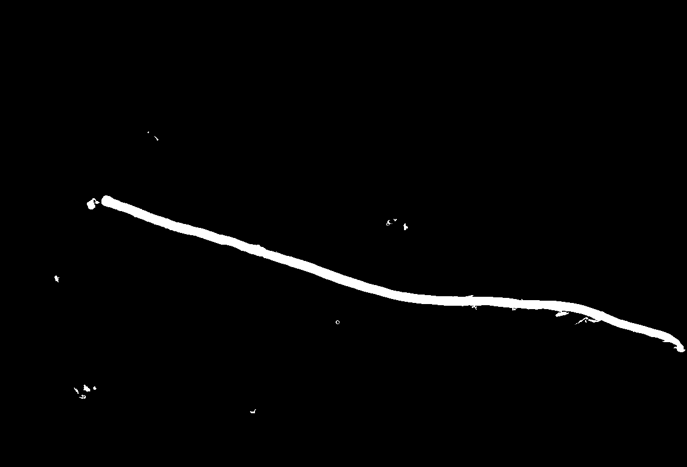

### Detecting Blurry Areas

In this example, we will work with the following images:

| 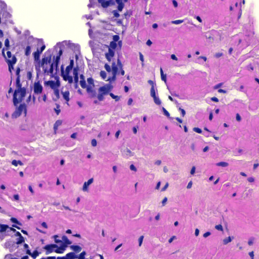 | 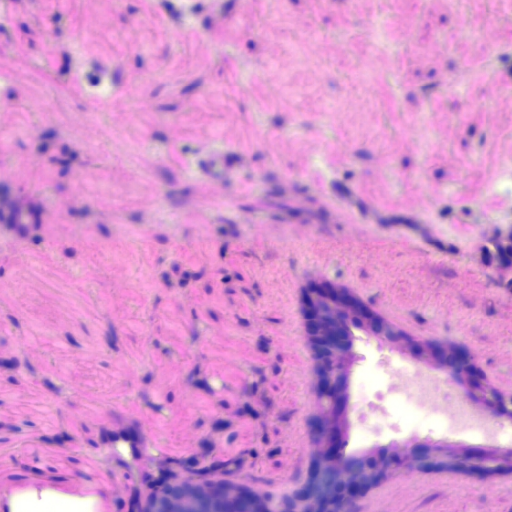 | 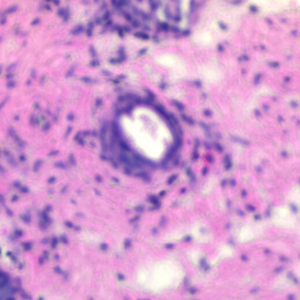 |
|:--------------------------------------:|:------------------------------------------------:|:--------------------------------------:|
| Focused Image                          | Partially Blurred Image                          | Blurred Image                          |

First, we need to import the necessary functionality and load the images into numpy arrays:

```python linenums="1"
import numpy as np
import pyvips
from PIL import Image
from rationai.masks import tissue_mask
from rationai.qc import blur_score_piqe


img_a = np.asarray(Image.open("blur_A.png").convert("RGB"))  # Focused image
img_b = np.asarray(Image.open("blur_B.png").convert("RGB"))  # Partially blurred image
img_c = np.asarray(Image.open("blur_C.png").convert("RGB"))  # Blurred image
```

Next, we will need to prepare the arguments for the [blur_score_piqe](../api/blur/blur-score-piqe.md) function and call it on the input images:

```python linenums="12"
pixel_size = 0.44  # pixel size of input images in micrometers

# blur score without tissue mask
blur_score_a = blur_score_piqe(img_a, pixel_size)
blur_score_b = blur_score_piqe(img_b, pixel_size)

tissue_mask_img = tissue_mask(
    pyvips.Image.new_from_array(img_c), mpp=pixel_size
).numpy()

tissue_mask_img = (tissue_mask_img > 0).astype(int)  # binarize mask

# blur score with tissue mask
blur_score_c = blur_score_piqe(img_c, pixel_size, tissue_mask_img)
```

The `pixel_size` parameter is used to calculate the kernel size for median filter that is used during the computation.
The function gives most accurate results on images with pixel size around 0.44 micrometers.
The `tissue_mask` param is optional and will be calculated inside the function if not present, but can be provided by the user to avoid unnecessary computation.

The blur function outputs 2 masks - `blur_score_coverage` and `blur_score_per_pixel`.
`blur_score_per_pixel` is a binary mask marking the areas of the image that are considered blurred, while `blur_score_coverage` provides a blur coverage score for the whole image indicating the degree of blur.

After obtaining the results, we can save the computed blur score masks.
Since `blur_score_coverage` is homogeneous across the image, we can just print out any value from the score mask for quick inspection:

```python linenums="29"
print(blur_score_a["blur_score_coverage"][0][0])

# save the coverage masks

mask = Image.fromarray((255 * blur_score_a["blur_score_coverage"]).astype(np.uint8))
mask.save("blur_score_a.png")

mask = Image.fromarray((255 * blur_score_b["blur_score_coverage"]).astype(np.uint8))
mask.save("blur_score_b.png")

mask = Image.fromarray((255 * blur_score_c["blur_score_coverage"]).astype(np.uint8))
mask.save("blur_score_c.png")


# save the per pixel masks

mask = Image.fromarray((255 * blur_score_a["blur_score_per_pixel"]).astype(np.uint8))
mask.save("blur_score_a_pixel.png")

mask = Image.fromarray((255 * blur_score_b["blur_score_per_pixel"]).astype(np.uint8))
mask.save("blur_score_b_pixel.png")

mask = Image.fromarray((255 * blur_score_c["blur_score_per_pixel"]).astype(np.uint8))
mask.save("blur_score_c_pixel.png")
```

#### Results

Coverage scores range from 0 to 1, where 0 represents the best focus and 1 represents complete blur.

| Score        | Focus Level                  |
|--------------|------------------------------|
| 0 - 0.1      | Perfect/almost perfect focus |
| 0.1 - 0.3    | Slightly/partially blurred   |
| 0.3 - 0.7    | Visibly blurred              |
| 0.7 - 1      | Severely blurred             |

In our example, the focus scores and masks look like this:

| 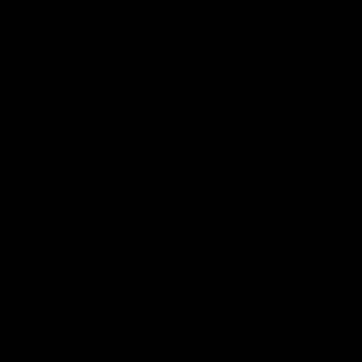 |  | 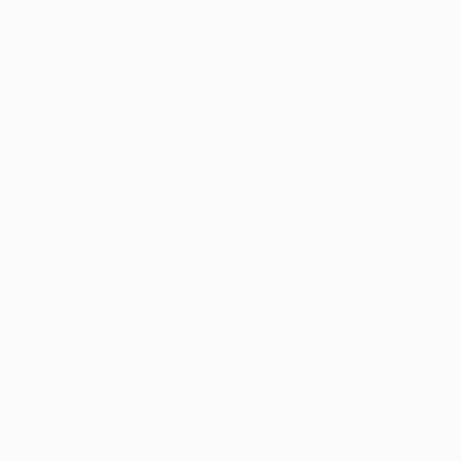 |
|:--------------------------------------------:|:------------------------------------------------------:|:--------------------------------------------:|
| Focused Image, Score ~0.005                  | Partially Blurred Image, Score ~0.488                  | Blurred Image, Score ~0.985                  |

Per-pixel mask is binary mask composed of 16x16 px blocks marking blurred areas.
Background pixels and focused blocks are marked as 0, while blurred blocks are marked as 1.

| 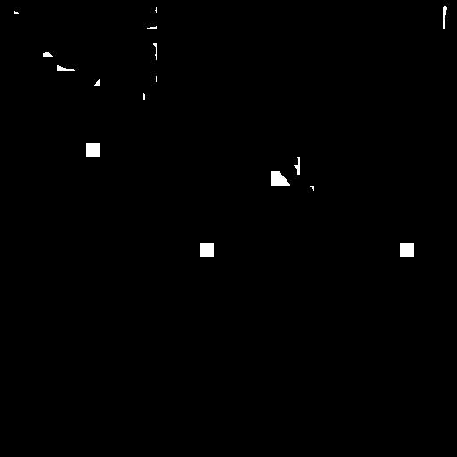 | 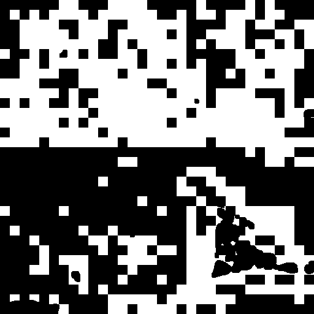 | 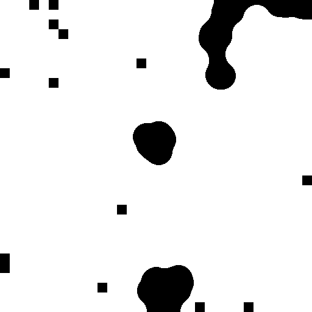 |
|:--------------------------------------------------:|:------------------------------------------------------------:|:--------------------------------------------------:|
| Focused Image                                      | Partially Blurred Image                                      | Blurred Image                                      |

Please note that blocks of the per-pixel mask may be 1 not only for globally blurred regions, but also for locally defocused or sparse areas (e.g. tissue gaps or empty regions). This means a value of 1 does not always imply a complete blur.

### Detecting Folded Areas

In this example, we will work with the following images:

The investigated tile.

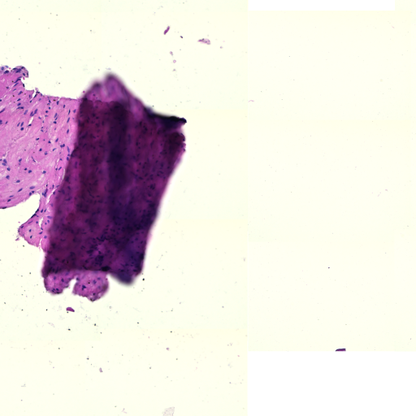

The local area of the tile.

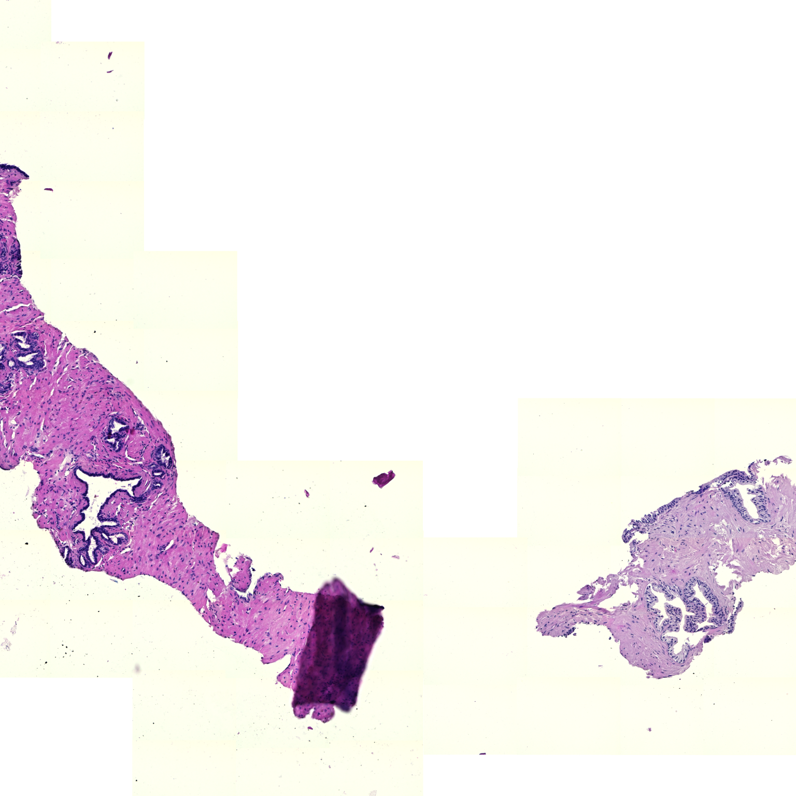

The local area is an optional image. It increases the detection rate of particularly large folds. A suggested size is `(3 * width, 3 * height)` of the investigated image.

#### Sample Code

First, we need to import the necessary functionality and load the images into numpy arrays:

```python linenums="1"
import numpy as np
import pyvips
from PIL import Image
from rationai.masks import tissue_mask
from rationai.qc import folding


mpp = 1.76
img = np.asarray(Image.open("fold.png").convert("RGB"))  # Investigated image
neigborhood_image = np.asarray(
    Image.open("fold_area.png").convert("RGB")
)  # Neighborhood area of investigated image
```

Now we can calculate the tissue masks:

```python linenums="12"
img_mask = tissue_mask(pyvips.Image.new_from_array(img), mpp=mpp).numpy() > 0

neighborhood_mask = (
    tissue_mask(pyvips.Image.new_from_array(neigborhood_image), mpp=mpp).numpy() > 0
)
```

Now we have all the arguments prepared. The folding function can be called:

```python linenums="20"
artifacts = folding(
    img=img,
    mpp=mpp,
    hematoxylin_eosin_stained=True,
    tissue_mask=img_mask,
    neighborhood_tiles=neigborhood_image,
    neighborhood_mask=neighborhood_mask,
)
```

#### Results

To recover the results, one needs to access the `artifacts` dictionary.

```python linenums="27"
mask = Image.fromarray(255 * artifacts["folding_per_pixel"].astype(np.uint8))
```

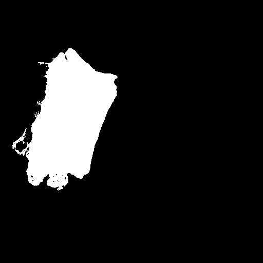
